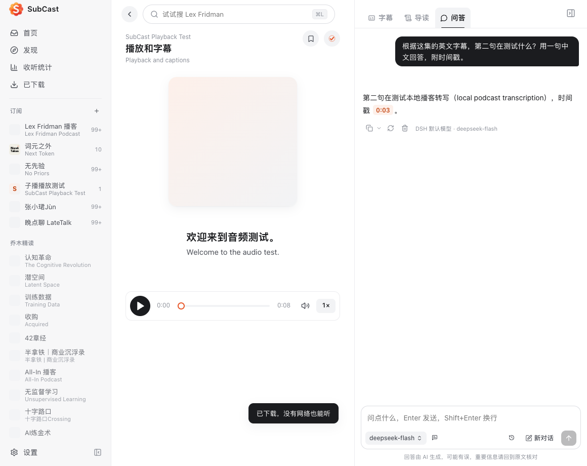

# 声渡 · SubCast for DeepSeek Harness

**中文** · [English](#english)

在 DeepSeek Harness 里订阅播客和 YouTube，跟读带时间轴的双语字幕，直接向当前单集提问。

Listen to podcasts and YouTube in DSH, follow bilingual transcripts, and ask questions about the episode.

[下载安装包](https://github.com/joeseesun/qiaomu-subcast-dsh/releases/latest) · [报告问题](https://github.com/joeseesun/qiaomu-subcast-dsh/issues) · [AGPL-3.0](LICENSE)


## 安装

预构建包支持 **DeepSeek Harness 0.2.2-rc.3**。从 [GitHub Release](https://github.com/joeseesun/qiaomu-subcast-dsh/releases/latest) 下载对应系统和架构的 `.tgz`。

| 平台 | 安装包后缀 | 安装环境 |
| --- | --- | --- |
| Windows x64 | `win32-x64.tgz` | Windows 上的 DSH Web，或使用 DSH 桌面版随附的 CLI |
| Linux x64 | `linux-x64.tgz` | 本机 DSH Web，Ubuntu 22.04 或同等运行库 |
| Linux ARM64 | `linux-arm64.tgz` | 本机 DSH Web，Ubuntu 24.04 或同等运行库 |
| Apple Silicon Mac | `darwin-arm64.tgz` | macOS 15+，DSH 桌面版或本机 Web |

**Windows、Linux 和 macOS 的 DSH Web**

使用 Node.js 24 安装 DSH CLI 和 pnpm。已有 `web` profile 时可直接安装；首次使用可先启动一次 DSH Web。

```sh
npm install -g @deepseek-ai/dsh@0.2.2-rc.3 pnpm@11.28.5
dsh --profile web
```

在下载目录运行相应命令。使用其他 Web profile 时，将 `web` 改为对应的名称。

```powershell
dsh plugin --profile web add .\qiaomu-subcast-dsh-0.1.4-win32-x64.tgz
```

```sh
dsh plugin --profile web add ./qiaomu-subcast-dsh-0.1.4-linux-x64.tgz
```

ARM64 Linux 和 Apple Silicon Mac 用户用表中对应的文件名替换命令中的包名。Linux 上的引擎使用系统的 `libdbus-1.so.3`，可通过发行版的 `libdbus-1-3` 或等价软件包安装。

**DSH 桌面版**

使用桌面版随附的 CLI，把安装包加入已有的 `desktop` profile。Windows 可使用 DSH 桌面菜单安装的 `dsh` 命令，并从上面的 PowerShell 命令将 `--profile web` 改为 `--profile desktop`。macOS 可运行以下命令。

```sh
DSH="/Applications/DeepSeek Harness.app/Contents/Resources/runtime/cli/bin/dsh"
"$DSH" plugin --profile desktop add ./qiaomu-subcast-dsh-0.1.4-darwin-arm64.tgz
```

重新启动该 profile（桌面版需完全退出后重新打开），在侧栏点击 **SubCast · 声渡**。

## 使用声渡

在顶部粘贴节目链接或 RSS，按回车订阅。点开单集，字幕就绪后切到「问答」。点击回答里的时间戳即可回听对应片段。

| 功能 | 用法 |
| --- | --- |
| 订阅与导入 | 添加 RSS、Apple Podcasts、小宇宙、YouTube 和乔木精读。支持导入和导出 OPML。 |
| 播放与收藏 | 记录收听进度，调整倍速，加入队列，收藏或下载音频离线播放。 |
| 字幕与翻译 | 读取节目方字幕和共享字幕，也可用本机 Whisper、Qwen3-ASR 或配置好的云端服务转写。 |
| 问答与导读 | 默认优先使用 DSH 已登录的 DeepSeek 账号。可搜索宿主模型、选用 API 服务或本机 AI CLI，也可选回跟随 DSH 默认模型。 |

<details>
<summary>查看单集问答</summary>



</details>

截图取自 Apple Silicon 上的 DSH 0.2.2-rc.3 测试环境，使用合成音频与示例字幕。

## 本地数据与网络

- 订阅、收藏、进度、字幕、对话和下载默认保存在 `${DSH_HOME:-$HOME/.dsh}/plugin-data/qiaomu-subcast-dsh`。可通过插件的 `config.dataDir` 指定其他目录。
- 声渡面板和 Rust 引擎之间的 HTTP 服务绑定本机回环地址。独立配置的服务商 Key 由系统钥匙串保存。使用 DSH 模型时沿用宿主的登录或凭据。
- 问答和导读会把相关字幕和问题发给所选模型。云端转写会上传音频。播客订阅、在线播放和字幕查询会访问对应的内容源。
- 「匿名分享我生成的字幕、译文和导读」默认开启，支持在声渡的「设置 → 通用」关闭。分享会向共享字幕服务提交内容和随机安装标识。

<details>
<summary>迁移 SubCast 桌面版资料库</summary>

先关闭原版和声渡插件，再运行以下命令。目标目录应尚未创建。脚本会对 SQLite 库做一致性备份，并复制离线下载和模型。

```sh
python3 scripts/import-library.py \
  "$HOME/Library/Application Support/ai.qiaomu.subcast" \
  "${DSH_HOME:-$HOME/.dsh}/plugin-data/qiaomu-subcast-dsh"
```

已有插件资料库时，可导入到新的目录后设置 `config.dataDir`。独立版保存的 API Key 需要在插件中重新配置。

</details>

卸载时运行 `dsh plugin --profile web remove qiaomu-subcast-dsh`，将 `web` 替换为安装时使用的 profile。从桌面版卸载时使用其随附的 CLI。数据目录可留作备份或迁移，确定不再需要时再单独删除。

## 开发与来源

DSH Host 注册本机连接入口和模型服务，Client 注册侧栏和主面板。React 界面通过本机服务与 Rust 引擎通信。共享字幕 API 源码位于 [server](server/)。

需要 Node.js 24、Rust、C/C++ 工具链、CMake 和 libclang。源码构建使用以下命令。

```sh
npm ci
npm run build
npm test
npm run i18n -- --strict
(cd native && cargo test --release --locked)
npm --prefix server test
npm run package:platform -- artifacts
```

发布验收在 Windows x64、Linux x64、Linux ARM64 和 Apple Silicon 的原生 runner 上运行。每个包都用干净的 DSH Web profile 验证侧栏、RSS 订阅、下载和离线播放。这组测试使用本地 WAV，并在临时 profile 中关闭宿主的模型登录引导。AI 服务和外部站点取决于用户配置与网络环境。

插件改编自 [SubCast 0.2.8](https://github.com/joeseesun/subcast/tree/ca578c5ed201e5e18bab63afd4d72dcf515532cb)，沿用 [AGPL-3.0-only](LICENSE)。服务商图标及其许可见 [图标来源](src/assets/providers/LICENSE.md)。欢迎提交可复现的问题和改进。 [贡献说明](CONTRIBUTING.md) · [安全报告](SECURITY.md)

## English

SubCast is an open-source DSH plugin for podcasts, YouTube, bilingual transcripts, offline audio and episode Q&A. Q&A and guides prefer the DeepSeek account signed in to DSH and fall back to the host default when that account is unavailable. You can also pick a different model in SubCast.

**Install.** Select the [release package](https://github.com/joeseesun/qiaomu-subcast-dsh/releases/latest) for Windows x64, Linux x64 or ARM64, or Apple Silicon macOS 15+. Use the [installation commands](#安装) with DSH 0.2.2-rc.3. Restart the profile and open **SubCast · 声渡** in the sidebar. The release matrix installs each package into a clean DSH Web profile and exercises RSS subscription, download and offline playback on its native OS.

**Data and privacy.** The library stays under `${DSH_HOME:-$HOME/.dsh}/plugin-data/qiaomu-subcast-dsh`. Selected model providers receive the prompts and transcript excerpts used in requests. Cloud transcription sends audio to the configured provider. Anonymous sharing of generated transcripts, translations and guides is enabled by default and can be turned off in **Settings → General**.

**Uninstall.** Run `dsh plugin --profile web remove qiaomu-subcast-dsh` with the profile you used for installation, then restart DSH. Keep the data directory if you intend to reinstall or migrate.

The source is based on [SubCast](https://github.com/joeseesun/subcast) and is available under [AGPL-3.0-only](LICENSE).
