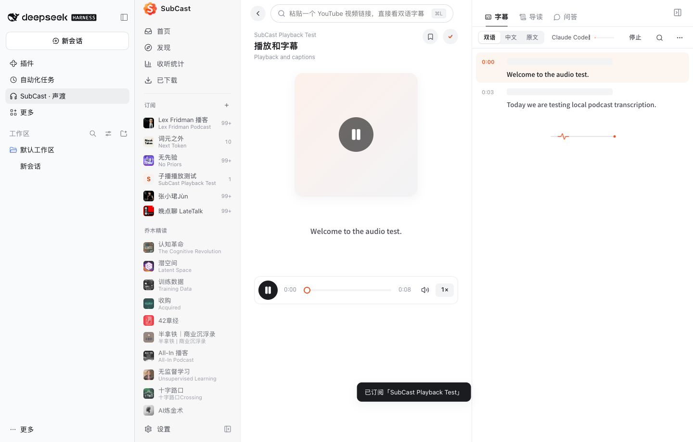

# 声渡 · SubCast for DeepSeek Harness

**中文** · [English](#english)

在 DeepSeek Harness 里订阅播客和 YouTube，跟读带时间轴的双语字幕，直接向当前单集提问。

Listen to podcasts and YouTube in DSH, follow bilingual transcripts, and ask questions about the episode.

[下载安装包](https://github.com/joeseesun/qiaomu-subcast-dsh/releases/latest) · [报告问题](https://github.com/joeseesun/qiaomu-subcast-dsh/issues) · [AGPL-3.0](LICENSE)



## 安装

预构建包适用于 **Apple Silicon Mac（macOS 15 或更高版本）** 和 **DeepSeek Harness 0.2.2-rc.3**。安装时沿用 DSH 已有的 `desktop` profile，无需本地编译。

```sh
curl -fL -O https://github.com/joeseesun/qiaomu-subcast-dsh/releases/download/v0.1.3/qiaomu-subcast-dsh-0.1.3-darwin-arm64.tgz
DSH="/Applications/DeepSeek Harness.app/Contents/Resources/runtime/cli/bin/dsh"
"$DSH" plugin --profile desktop add ./qiaomu-subcast-dsh-0.1.3-darwin-arm64.tgz
```

完全退出并重新打开 DSH，在侧栏点击 **SubCast · 声渡**。本机 DSH Web 用户也可用同一安装包，将 `desktop` 换成正在使用的 Web profile，再重启该 profile。

## 使用声渡

在顶部粘贴节目链接或 RSS，按回车订阅。点开单集，字幕就绪后切到「问答」。点击回答里的时间戳即可回听对应片段。

| 功能 | 用法 |
| --- | --- |
| 订阅与导入 | 添加 RSS、Apple Podcasts、小宇宙、YouTube 和乔木精读。支持导入和导出 OPML。 |
| 播放与收藏 | 记录收听进度，调整倍速，加入队列，收藏或下载音频离线播放。 |
| 字幕与翻译 | 读取节目方字幕和共享字幕，也可用本机 Whisper、Qwen3-ASR 或配置好的云端服务转写。 |
| 问答与导读 | 默认优先使用 DSH 已登录的 DeepSeek 账号。可搜索宿主模型、选用 API 服务或本机 AI CLI，也可选回跟随 DSH 默认模型。 |

<details>
<summary>查看单集问答</summary>


</details>

截图取自 Apple Silicon 上的 DSH 0.2.2-rc.3 测试环境，使用合成音频与示例字幕。

## 本地数据与网络

- 订阅、收藏、进度、字幕、对话和下载默认保存在 `${DSH_HOME:-$HOME/.dsh}/plugin-data/qiaomu-subcast-dsh`。可通过插件的 `config.dataDir` 指定其他目录。
- 声渡面板和 Rust 引擎之间的 HTTP 服务绑定本机回环地址。独立配置的服务商 Key 由系统钥匙串保存。使用 DSH 模型时沿用宿主的登录或凭据。
- 问答和导读会把相关字幕和问题发给所选模型。云端转写会上传音频。播客订阅、在线播放和字幕查询会访问对应的内容源。
- 「匿名分享我生成的字幕、译文和导读」默认开启，支持在声渡的「设置 → 通用」关闭。分享会向共享字幕服务提交内容和随机安装标识。

<details>
<summary>迁移 SubCast 桌面版资料库</summary>

先关闭原版和声渡插件，再运行以下命令。目标目录应尚未创建。脚本会对 SQLite 库做一致性备份，并复制离线下载和模型。

```sh
python3 scripts/import-library.py \
  "$HOME/Library/Application Support/ai.qiaomu.subcast" \
  "${DSH_HOME:-$HOME/.dsh}/plugin-data/qiaomu-subcast-dsh"
```

已有插件资料库时，可导入到新的目录后设置 `config.dataDir`。独立版保存的 API Key 需要在插件中重新配置。

</details>

卸载时运行 `"$DSH" plugin --profile desktop remove qiaomu-subcast-dsh`，然后重启 DSH。数据目录可留作备份或迁移，确定不再需要时再单独删除。

## 开发与来源

DSH Host 注册本机连接入口和模型服务，Client 注册侧栏和主面板。React 界面通过本机服务与 Rust 引擎通信。共享字幕 API 源码位于 [server](server/)。

需要 Node.js 24、Rust、C/C++ 工具链、CMake 和 libclang。源码构建使用以下命令。

```sh
npm ci
npm run build
npm test
npm run i18n -- --strict
(cd native && cargo test --release --locked)
npm --prefix server test
npm pack --ignore-scripts
```

| 环境 | 验证范围 |
| --- | --- |
| Apple Silicon macOS 15+ · DSH 0.2.2-rc.3 Desktop / 本机 Web | 已验证侧栏、订阅、字幕、离线播放和 DSH 模型调用。|
| Intel Mac、Windows、Linux 和其他 DSH 版本 | 当前公开包的兼容范围为 Apple Silicon 和上述 DSH 版本。|

插件改编自 [SubCast 0.2.8](https://github.com/joeseesun/subcast/tree/ca578c5ed201e5e18bab63afd4d72dcf515532cb)，沿用 [AGPL-3.0-only](LICENSE)。服务商图标及其许可见 [图标来源](src/assets/providers/LICENSE.md)。欢迎提交可复现的问题和改进。 [贡献说明](CONTRIBUTING.md) · [安全报告](SECURITY.md)

## English

SubCast is an open-source DSH plugin for podcasts, YouTube, bilingual transcripts, offline audio and episode Q&A. Q&A and guides prefer the DeepSeek account signed in to DSH and fall back to the host default when that account is unavailable. You can also pick a different model in SubCast.

**Install.** Download the [Apple Silicon package](https://github.com/joeseesun/qiaomu-subcast-dsh/releases/latest) and run the two desktop CLI steps in the [installation section](#安装). Restart DSH 0.2.2-rc.3 and open **SubCast · 声渡** in the sidebar. The same package works with an existing local Web profile of that version. Paste an RSS feed or episode URL, open the episode and select **Q&A** when a transcript is ready.

**Data and privacy.** The library stays under `${DSH_HOME:-$HOME/.dsh}/plugin-data/qiaomu-subcast-dsh`. Selected model providers receive the prompts and transcript excerpts used in requests. Cloud transcription sends audio to the configured provider. Anonymous sharing of generated transcripts, translations and guides is enabled by default and can be turned off in **Settings → General**.

**Uninstall.** Run `"$DSH" plugin --profile desktop remove qiaomu-subcast-dsh` and restart DSH. Keep the data directory if you intend to reinstall or migrate.

The supplied binary targets Apple Silicon macOS 15+ and DSH 0.2.2-rc.3. The source is based on [SubCast](https://github.com/joeseesun/subcast) and is available under [AGPL-3.0-only](LICENSE).
